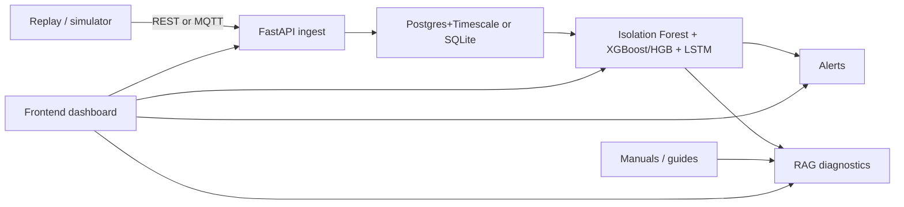

# Auravance Demo Backend Architecture

Local demo stack in this repo. Production MQTT/Timescale/pgvector remains in
`docs/backend-architecture.md`.

## Demo Architecture

## What is running locally

- FastAPI `/api/v1` with JWT reads/writes and `X-Ingest-Key` ingest
- PostgreSQL + Timescale when `AURAVANCE_DATABASE_URL` is set (`docker compose`); else SQLite at `data/auravance_demo.db`
- REST `POST /telemetry/ingest` and `/ingest/batch`
- MQTT subscriber on `plants/{plant_id}/lines/{line_id}/assets/{asset_id}/telemetry` (compose Mosquitto or embedded broker for tests)
- Ingest scoring on a Redis worker when `AURAVANCE_REDIS_URL` is set; otherwise inline
- Isolation Forest anomalies; XGBoost tabular failure/RUL when artifacts exist, else HistGradientBoosting; rules fallback
- LSTM sequence failure scoring when PyTorch and sequence artifacts are present
- RAG over manuals/guides with OpenAI or TF-IDF and a playbook fallback
- Replay datasets in `data/replay/` (Kaggle pump, MetroPT-3, NASA/IMS)

## Deliberately still pending

- pgvector
- HA MQTT cluster (compose ships one Mosquitto, not EMQX/HiveMQ)
- 1M+ records/day and retention policies
- A 30% detection-accuracy claim (measure first with `scripts/evaluate_detection_delta.py`)
